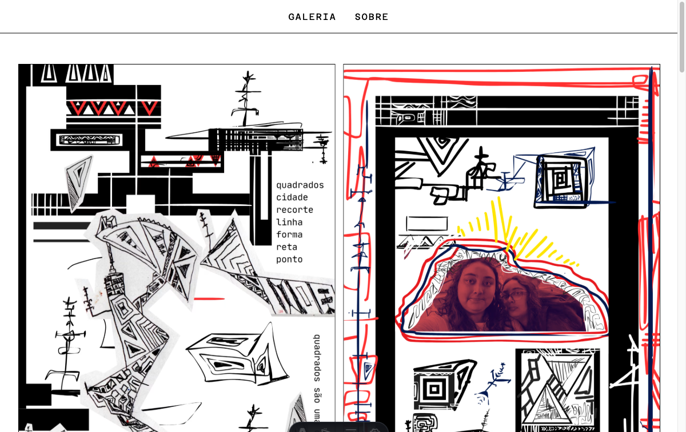

# Quadrados

[](https://astro.build/)
[](https://cloudinary.com/)



Quadrados is a small black-and-white photography and drawing gallery. It presents selected square studies in a responsive Astro site, with image discovery and optimization handled through Cloudinary.

## Features

- Responsive gallery that preserves each image's original aspect ratio.
- Cloudinary search for images in a configured folder.
- Optimized responsive URLs with automatic format and quality selection.
- Minimal monochrome layout using Azeret Mono typography.
- About page with a link to the author's personal website.

## Tech Stack

- Astro 5.14.7.
- TypeScript.
- Cloudinary image API.
- Sharp and Plaiceholder for image processing.

## Getting Started

### Prerequisites

- Node.js with pnpm available.
- A Cloudinary account and a folder containing the gallery images.

### Configure environment variables

Create a local `.env` file. Keep it out of version control:

```env
CLOUDINARY_CLOUD_NAME=your_cloud_name
CLOUDINARY_API_KEY=your_api_key
CLOUDINARY_API_SECRET=your_api_secret
CLOUDINARY_FOLDER_NAME=galeria
```

### Install and run

```sh
pnpm install
pnpm dev
```

The development server runs at `http://localhost:4321` by default.

### Production build

```sh
pnpm build
pnpm preview
```

## Routes

| Route | Purpose |
| --- | --- |
| `/` | Image gallery |
| `/about` | Project and author information |
| `/image/[id]` | Individual image page |

## Project Structure

```text
src/
├── components/Gallery.astro  Gallery rendering and image layout
├── layouts/Layout.astro      Shared page shell and navigation
├── lib/cloudinary.ts         Cloudinary client and responsive URLs
├── lib/config.ts             Environment-backed configuration
├── pages/                    File-based routes
└── styles/global.css         Global monochrome styling
public/                       Static favicon and social preview assets
```

Change the gallery folder through `CLOUDINARY_FOLDER_NAME`. Adjust the grid and responsive behavior in `src/components/Gallery.astro`; image transformations are centralized in `src/lib/cloudinary.ts`.

## License

No license is currently declared in the repository.
